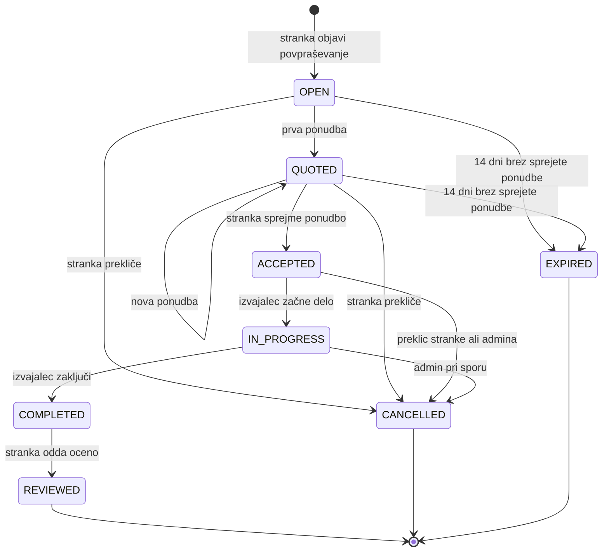

# 02 Funkcionalnosti in obseg

## Uporabniške vloge

Vsak registriran uporabnik ima eno vlogo: stranka, izvajalec ali administrator. Pravice preverja backend pri vsaki zahtevi, frontend samo skrije gumbe, ki jih uporabnik ne sme uporabiti. Neprijavljen obiskovalec lahko pogleda kategorije in javne profile mojstrov, kaj več pa ne.

### Stranka

Stranka objavlja povpraševanja in jih lahko ureja, dokler nanje še ni prišla nobena ponudba. Kadarkoli pred začetkom dela jih lahko tudi prekliče. Vidi ponudbe za svoja povpraševanja, jih primerja in sprejme eno. Potem spremlja status dela in na koncu odda oceno, vendar samo eno na delo.

Ne more pa videti povpraševanj in ponudb drugih strank, pošiljati ponudb ali sama označiti dela kot začetega oz. zaključenega, ker je to naloga mojstra. Oceno lahko popravi le prvih 7 dni.

### Izvajalec

Izvajalec si uredi profil z nazivom podjetja, davčno številko, kategorijami, ki jih pokriva, in poštnimi številkami, kjer dela. Vidi odprta povpraševanja, ki se ujemajo z njegovimi kategorijami in območjem, in na vsako lahko pošlje eno ponudbo. Dokler stranka ne odloči, lahko ponudbo spremeni ali umakne. Pri sprejetih delih spreminja status (začeto, zaključeno), na prejeto oceno pa lahko enkrat javno odgovori.

Ponudb ne more pošiljati, dokler ga administrator ne preveri. Tudi ne vidi ponudb drugih mojstrov, ne more objavljati povpraševanj, ne more sprejemati ponudb in ne more urejati ali brisati ocen, ki jih je dobil.

### Administrator

Administrator preverja nove izvajalce (pogleda naziv in davčno številko ter jih potrdi ali zavrne), ureja seznam kategorij, lahko blokira uporabnika in skrije neprimerno oceno ali povpraševanje. Če pride do spora, lahko delo prekliče.

Ne more pa namesto uporabnikov pošiljati ali sprejemati ponudb, pisati ocen ali spreminjati cen v ponudbah. Gesel ne vidi, ker se v bazi hranijo samo kot Argon2 hash.

## Predvidene funkcionalnosti

Za prvo delujočo različico (MVP) smo izbrali 6 funkcionalnosti. Pet od njih (F2 do F6) je vezanih na samo domeno.

| # | Funkcionalnost | MVP |
|---|---|---|
| F1 | Registracija in prijava z izbiro vloge (stranka ali izvajalec), JWT | MVP |
| F2 | Objava povpraševanja s kategorijo, opisom, krajem, poštno številko, želenim terminom in po želji okvirnim proračunom | MVP |
| F3 | Seznam ustreznih povpraševanj za izvajalca, filtriran po njegovih kategorijah in poštnih številkah | MVP |
| F4 | Oddaja ponudbe (cena, ocena trajanja, najzgodnejši termin, sporočilo), ena na izvajalca in povpraševanje | MVP |
| F5 | Primerjava ponudb in sprejem ene, pri čemer se ostale samodejno zavrnejo | MVP |
| F6 | Spremljanje statusa dela po določenem poteku, z zgodovino sprememb | MVP |
| F7 | Ocena izvajalca po zaključenem delu (1 do 5 zvezdic in komentar) | |
| F8 | Preverjanje izvajalcev s strani administratorja | |
| F9 | Javni profil izvajalca z ocenami in številom opravljenih del | |
| F10 | Urejanje kategorij storitev | |
| F11 | Samodejni potek povpraševanja po 14 dneh, če ni sprejete ponudbe | |
| F12 | Pregled za izvajalca: ponudbe po statusih, prihajajoča dela, koliko ponudb je bilo sprejetih | |
| F13 | Moderiranje (skrivanje ocen, blokiranje uporabnikov) | |
| F14 | Iskanje izvajalcev po kategoriji, kraju in minimalni oceni | |

Ocene (F7) in preverjanje izvajalcev (F8) pridejo na vrsto takoj za MVP. Do takrat bomo testne izvajalce označili kot preverjene kar v bazi oz. prek začetnih podatkov, da se lahko celoten potek vseeno preizkusi.

## Potek povpraševanja

To je najzahtevnejši del aplikacije. Povpraševanje ima status, ki se lahko spreminja samo po spodnjem diagramu, in vsak prehod lahko naredi samo določena vloga. Če nekdo poskusi narediti prehod, ki ni dovoljen, backend vrne napako (`409` ali `403`).

Ponudbo lahko pošlje samo preverjen izvajalec, čigar kategorija in območje se ujemata s povpraševanjem. Sprejme jo lahko samo stranka, ki je povpraševanje objavila. Ob sprejemu se v eni transakciji izbrana ponudba označi kot `ACCEPTED`, vse ostale pa kot `REJECTED`. Status `IN_PROGRESS` in `COMPLETED` nastavlja samo izvajalec, čigar ponudba je bila sprejeta. Stranka lahko prekliče do začetka dela, administrator pa tudi kasneje. Pri preklicu je treba vpisati razlog.

Ponudba ima svoje statuse: `PENDING`, `ACCEPTED`, `REJECTED` in `WITHDRAWN` (če jo mojster umakne).

## Kasnejše nadgradnje

- obvestila po e-pošti, ko pride nova ponudba ali se spremeni status
- dodajanje fotografij k povpraševanju (npr. slika pokvarjene pipe)
- iskanje po oddaljenosti na zemljevidu (PostGIS) namesto po poštnih številkah
- koledar, kjer mojster označi proste termine, stranka pa izbere točen termin
- sporočila med stranko in izbranim mojstrom pri posameznem delu
- slovenski in angleški vmesnik
- statistika za administratorja, npr. povprečna cena po kategorijah
- predpomnjenje pogostih poizvedb z Redisom, npr. seznam kategorij ali seznam ustreznih del za izvajalca

## Izven obsega

V tem projektu ne bomo delali:

- plačil v aplikaciji (stranka in mojster se za plačilo dogovorita sama)
- mobilnih aplikacij za iOS ali Android, aplikacija bo samo spletna in prilagojena za telefon
- klepeta v realnem času ali klicev
- samodejnega preverjanja podjetij v AJPES ali FURS, to administrator naredi ročno
- garancije za opravljeno delo, platforma ni stranka v dogovoru med stranko in mojstrom
- računov za podjetja z več zaposlenimi in razporejanja dela med njimi
