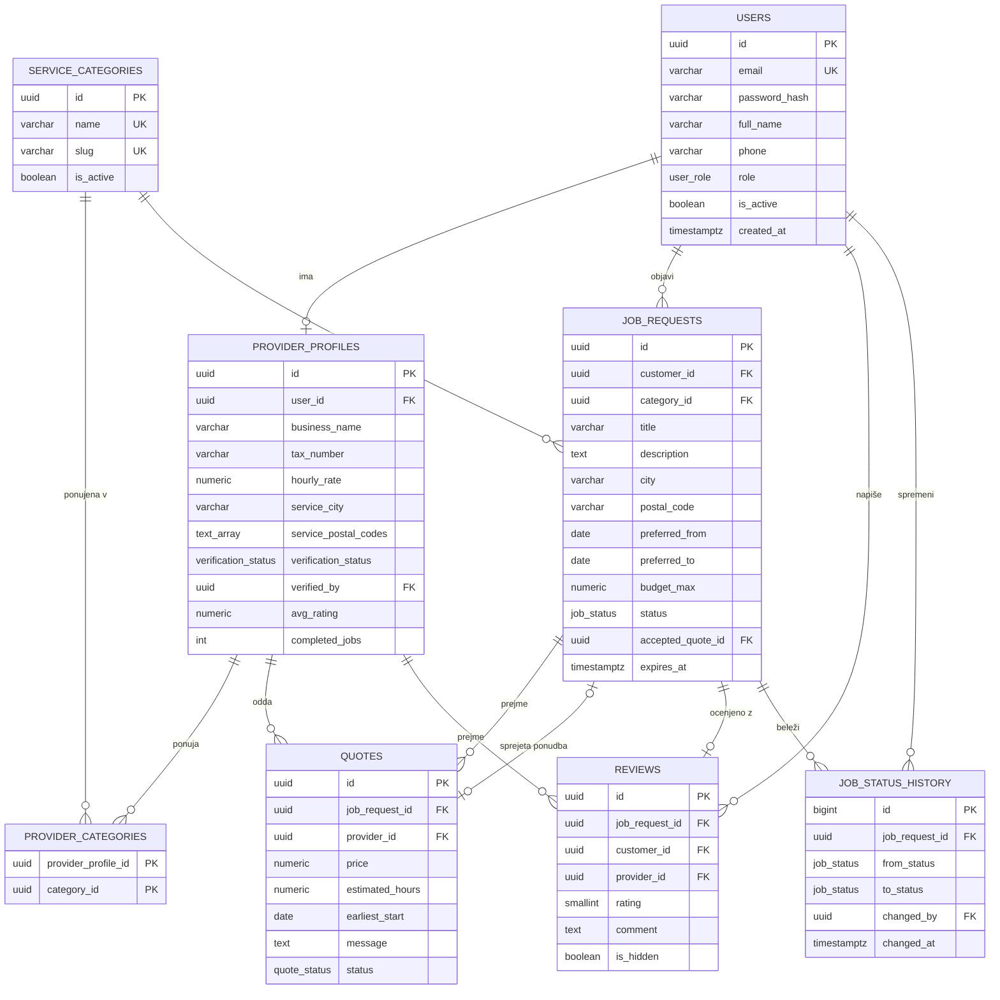

# 03 Podatkovni model

Podatki bodo v relacijski bazi PostgreSQL 18. Shemo bomo pisali kot migracije v SeaORM (`sea-orm-migration`), entitete v Rustu pa generirali iz baze s `sea-orm-cli generate entity`. Vsaka tabela tako postane svoja SeaORM entiteta.

Nekaj dogovorov, ki veljajo za vse tabele. Primarni ključi so `UUID`, razen pri zgodovini statusov, kjer zadošča `BIGSERIAL`. Čas hranimo kot `TIMESTAMPTZ`. Zneske hranimo kot `NUMERIC(10,2)` v evrih, da ne pride do napak pri zaokroževanju. Statusi in vloge so enum tipi v PostgreSQL, v Rustu pa enumi z `DeriveActiveEnum`.

## Entitete

### users

Vsi uporabniki, ne glede na vlogo.

| Polje | Tip | Opomba |
|---|---|---|
| id | UUID, PK | |
| email | VARCHAR(255), UNIQUE | uporablja se za prijavo |
| password_hash | VARCHAR(255) | Argon2id |
| full_name | VARCHAR(120) | |
| phone | VARCHAR(30), NULL | drugi strani se pokaže šele po sprejemu ponudbe |
| role | enum `user_role` | `CUSTOMER`, `PROVIDER`, `ADMIN` |
| is_active | BOOLEAN | false, če ga admin blokira |
| created_at, updated_at | TIMESTAMPTZ | |

### provider_profiles

Dodatni podatki za izvajalce. Vsak izvajalec ima natanko en profil.

| Polje | Tip | Opomba |
|---|---|---|
| id | UUID, PK | |
| user_id | UUID, FK → users, UNIQUE | |
| business_name | VARCHAR(150) | |
| tax_number | VARCHAR(20) | davčna številka |
| description | TEXT | |
| hourly_rate | NUMERIC(10,2), NULL | |
| service_city | VARCHAR(100) | |
| service_postal_codes | TEXT[] | poštne številke, kjer dela |
| verification_status | enum | `PENDING`, `VERIFIED`, `REJECTED` |
| verified_by | UUID, FK → users, NULL | kateri admin ga je preveril |
| verified_at | TIMESTAMPTZ, NULL | |
| avg_rating | NUMERIC(3,2) | izračuna se ob vsaki novi oceni |
| completed_jobs | INTEGER | |

### service_categories in provider_categories

`service_categories` ima polja `id` (UUID), `name`, `slug` in `is_active`. Primeri kategorij so Vodovodna dela, Elektrika in Pleskanje. Ker lahko izvajalec pokriva več kategorij in je v vsaki kategoriji več izvajalcev, imamo še vmesno tabelo `provider_categories` s stolpcema `provider_profile_id` in `category_id`, ki skupaj tvorita primarni ključ.

### job_requests

Povpraševanje, ki ga objavi stranka. To je glavna tabela, saj se okoli nje dogaja celoten potek.

| Polje | Tip | Opomba |
|---|---|---|
| id | UUID, PK | |
| customer_id | UUID, FK → users | |
| category_id | UUID, FK → service_categories | |
| title | VARCHAR(150) | |
| description | TEXT | |
| city, postal_code | VARCHAR | po poštni številki iščemo ustrezne izvajalce |
| address_line | VARCHAR(200), NULL | vidi ga samo izbrani izvajalec |
| preferred_from, preferred_to | DATE, NULL | želeni termin |
| budget_min, budget_max | NUMERIC(10,2), NULL | |
| status | enum `job_status` | `OPEN`, `QUOTED`, `ACCEPTED`, `IN_PROGRESS`, `COMPLETED`, `REVIEWED`, `CANCELLED`, `EXPIRED` |
| accepted_quote_id | UUID, FK → quotes, NULL | izbrana ponudba |
| expires_at | TIMESTAMPTZ | 14 dni po objavi |
| created_at, updated_at | TIMESTAMPTZ | |

### quotes

Ponudba izvajalca za eno povpraševanje.

| Polje | Tip | Opomba |
|---|---|---|
| id | UUID, PK | |
| job_request_id | UUID, FK → job_requests | |
| provider_id | UUID, FK → provider_profiles | |
| price | NUMERIC(10,2) | mora biti večja od 0 |
| estimated_hours | NUMERIC(5,1) | |
| earliest_start | DATE | |
| message | TEXT, NULL | |
| status | enum `quote_status` | `PENDING`, `ACCEPTED`, `REJECTED`, `WITHDRAWN` |
| created_at, updated_at | TIMESTAMPTZ | |

Par (`job_request_id`, `provider_id`) je unikaten, ker lahko mojster na isto povpraševanje pošlje samo eno ponudbo.

### reviews

Ocena po zaključenem delu. Polja so `id`, `job_request_id` (UNIQUE, ker je na delo samo ena ocena), `customer_id`, `provider_id`, `rating` (SMALLINT od 1 do 5), `comment`, `provider_reply` za odgovor mojstra, `is_hidden`, če jo admin skrije, in `created_at`.

### job_status_history

Vsaka sprememba statusa povpraševanja doda vrstico v to tabelo. Shranimo `job_request_id`, `from_status`, `to_status`, kdo je spremembo naredil (`changed_by`), opombo (npr. razlog preklica) in čas `changed_at`. Tako se lahko kasneje preveri, kaj se je dogajalo z delom.

## Povezave

Uporabnik ima lahko en profil izvajalca, vendar le če je njegova vloga `PROVIDER`. Med izvajalci in kategorijami je povezava M:N prek `provider_categories`.

Stranka ima lahko več povpraševanj, vsako povpraševanje pa spada v eno kategorijo. Na povpraševanje lahko pride več ponudb, vsaka od nekega izvajalca. Ena od teh ponudb je lahko sprejeta, nanjo kaže `accepted_quote_id`.

Zaključeno delo ima največ eno oceno, izvajalec pa jih ima lahko veliko. Povpraševanje ima več zapisov v zgodovini statusov, pri vsakem pa je zabeleženo, kateri uporabnik je spremembo naredil.

V SeaORM bomo to zapisali z `has_many` in `belongs_to` ter z implementacijo `Related`. Za povezavo M:N se uporabi `via()`.

## Diagram

## Omejitve in indeksi

Poleg zgoraj omenjenih unikatnih ključev bomo dodali še delni unikatni indeks na `quotes(job_request_id) WHERE status = 'ACCEPTED'`, da baza sama prepreči dve sprejeti ponudbi za isto povpraševanje. Seznam ustreznih del za izvajalca bo pogosta poizvedba, zato dobi indeks `job_requests(status, category_id, postal_code)`. Uporabnikov ne brišemo, ampak jih samo deaktiviramo, da zgodovina ostane cela. Zato so tuji ključi nastavljeni na `ON DELETE RESTRICT`.
