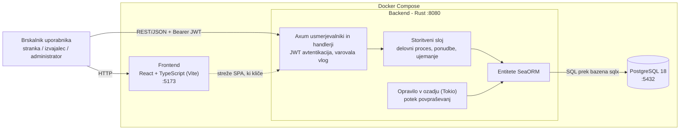

# 04 Arhitektura in tehnološki sklad

## Arhitektura

Aplikacija ima tri dele: frontend, backend in podatkovno bazo.

**Frontend** je enostranska aplikacija (SPA) v Reactu in TypeScriptu, zgrajena z Vite. Vsaka vloga ima svoje zaslone. Stranka ima obrazec za povpraševanje in primerjavo ponudb, izvajalec seznam ustreznih del in svojih ponudb, administrator pa preverjanje izvajalcev in kategorije.

**Backend** je REST API v Rustu z ogrodjem Axum, ki teče na Tokio. Tu je vsa poslovna logika: prijava, preverjanje pravic, validacija in pravila za spreminjanje statusov. Do baze dostopa prek SeaORM. V ozadju teče še manjše opravilo, ki enkrat na uro označi potekla povpraševanja.

Backend bo razdeljen na nekaj crate-ov v enem Cargo workspaceu:

```
backend/
  api/        # Axum routerji, handlerji, preverjanje JWT in vlog
  service/    # poslovna logika (potek dela, ponudbe, ujemanje)
  entity/     # SeaORM entitete
  migration/  # migracije in začetni podatki
```

Handlerji naj ostanejo kratki. Vse spremembe statusa gredo prek ene funkcije v `service`, ki preveri, ali je prehod dovoljen in ali ga sme narediti ta uporabnik. Nato v eni transakciji posodobi povpraševanje in doda zapis v `job_status_history`.

**Podatkovna baza** je PostgreSQL 18. Teče v Docker vsebniku, podatki pa so shranjeni v volumnu. Backend ob zagonu sam izvede migracije, ki ustvarijo tudi osnovne kategorije in prvega administratorja (podatki zanj so v `.env`). Model je opisan v `03-podatkovni-model.md`. Kasneje bi lahko za predpomnjenje pogostih poizvedb dodali še Redis, za MVP pa zadošča PostgreSQL.

### Komunikacija

Frontend in backend komunicirata prek HTTP, z JSON zahtevki na poteh pod `/api/v1`. Prijavljen uporabnik pošilja JWT v glavi `Authorization: Bearer ...`. Backend z bazo komunicira prek SeaORM (pod njim je `sqlx`) in uporablja pool povezav.

Nekaj glavnih endpointov, da je jasno, kako bo API videti:

- `POST /api/v1/auth/register` in `POST /api/v1/auth/login`
- `POST /api/v1/job-requests` za objavo povpraševanja
- `GET /api/v1/job-requests/matching` za seznam ustreznih del za izvajalca
- `POST /api/v1/job-requests/{id}/quotes` za oddajo ponudbe
- `POST /api/v1/quotes/{id}/accept` za sprejem ponudbe
- `POST /api/v1/job-requests/{id}/status` za spremembo statusa
- `PATCH /api/v1/admin/providers/{id}/verification` za preverjanje izvajalca

Napake vrača kot JSON s kodo napake (npr. `INVALID_TRANSITION`) in ustreznim HTTP statusom.

### Avtentikacija

Ob registraciji uporabnik izbere, ali je stranka ali izvajalec. Administratorja se ne da ustvariti prek registracije, prvega ustvari migracija. Gesla hashiramo z Argon2id. Ob prijavi backend vrne JWT, ki vsebuje id uporabnika, vlogo in čas veljavnosti (okoli 60 minut). V Axumu bo extractor, ki preveri žeton in naloži uporabnika, ter preverjanje vloge za posamezne poti. Preverjanje lastništva, npr. ali je to res povpraševanje te stranke, se naredi v service sloju.

### Lokalni zagon

Potrebna sta Docker in Docker Compose. Če želiš backend in frontend poganjati brez Dockerja, potrebuješ še Rust in Node.js 20.

```bash
git clone https://github.com/Denis-Feri-Mag/RIRS_Vaja_03.git
cd RIRS_Vaja_03
cp .env.example .env
docker compose up --build
```

V `.env` je treba nastaviti vsaj geslo za bazo, `JWT_SECRET` ter e-pošto in geslo prvega administratorja. Frontend je potem na `http://localhost:5173`, API na `http://localhost:8080/api/v1`, Swagger UI na `http://localhost:8080/swagger-ui`, baza pa na portu 5432.

Med razvojem je bolj praktično, da v Dockerju teče samo baza (`docker compose up db`). Backend se zažene s `cargo run -p api`, frontend pa z `npm run dev`.

### Diagram



## Tehnološki sklad

| Področje | Tehnologije |
|---|---|
| Frontend | React 18, TypeScript, Vite, React Router, TanStack Query, React Hook Form in Zod, Tailwind CSS |
| Backend | Rust, Axum, Tokio, tower-http (CORS, logiranje), serde, validator, tracing |
| Podatkovna baza | PostgreSQL 18, SeaORM, sea-orm-migration, sea-orm-cli |
| Avtentikacija | JWT (`jsonwebtoken`), Argon2id (`argon2`) |
| Lokalni razvoj | Docker Compose, `.env`, cargo-watch |
| Dokumentacija API | OpenAPI z `utoipa` in Swagger UI |
| Testiranje | `cargo test`, `axum-test`, Vitest in React Testing Library, kasneje Playwright |
| Kakovost kode in CI | rustfmt, clippy, ESLint, Prettier, GitHub Actions |

## Arhitekturne odločitve

- Frontend in backend sta ločena in se pogovarjata prek REST API, da ju lahko razvijamo in testiramo posebej.
- Backend je v Rustu z Axumom, ker veliko napak ujame že prevajalnik, statusi pa se lepo zapišejo kot enum.
- Podatki so v PostgreSQL, ker so močno povezani in rabimo transakcije, do baze dostopamo prek SeaORM.
- Prijava je z JWT, gesla hashiramo z Argon2id, tako da na strežniku ni treba hraniti sej.
- Pravila za statuse so na enem mestu v backendu, ker frontendu ne moremo zaupati.
- Imamo en backend namesto mikrostoritev, ker je projekt premajhen za kaj več.
- Lokalno se vse zažene z Docker Compose, da ima vsak enako okolje.

Podrobneje so odločitve opisane v mapi [adr](adr/).
