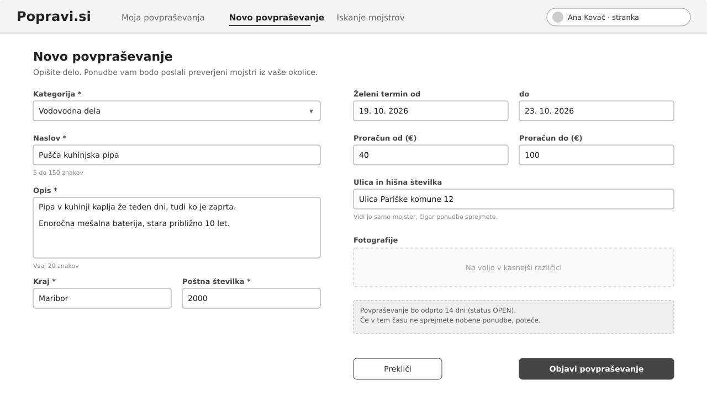
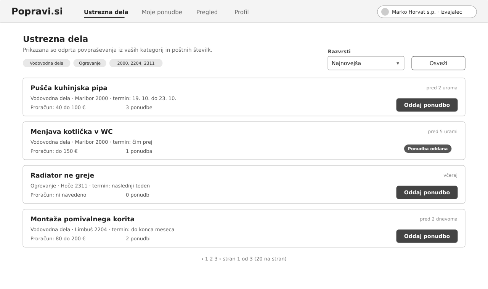
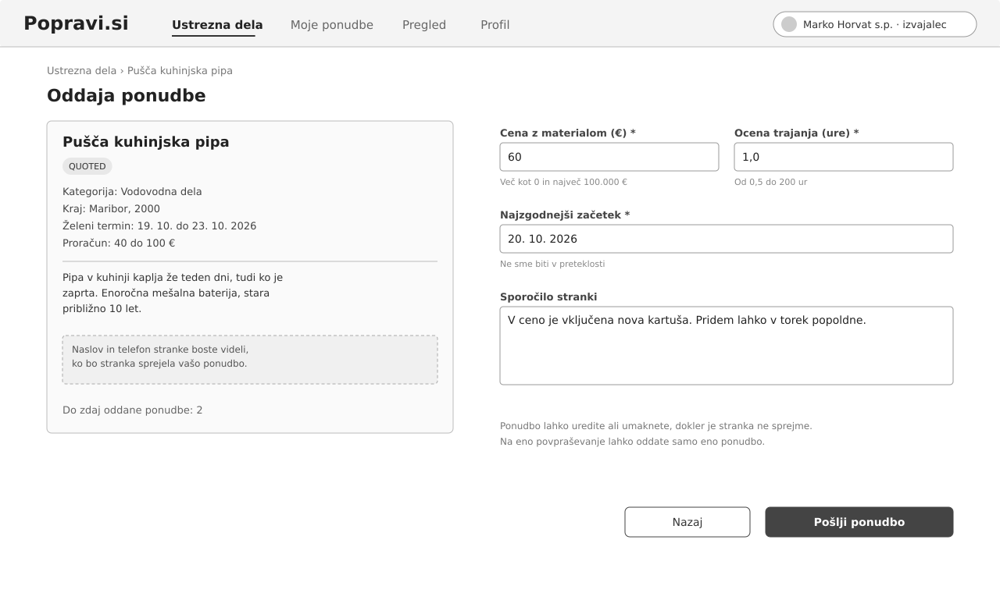
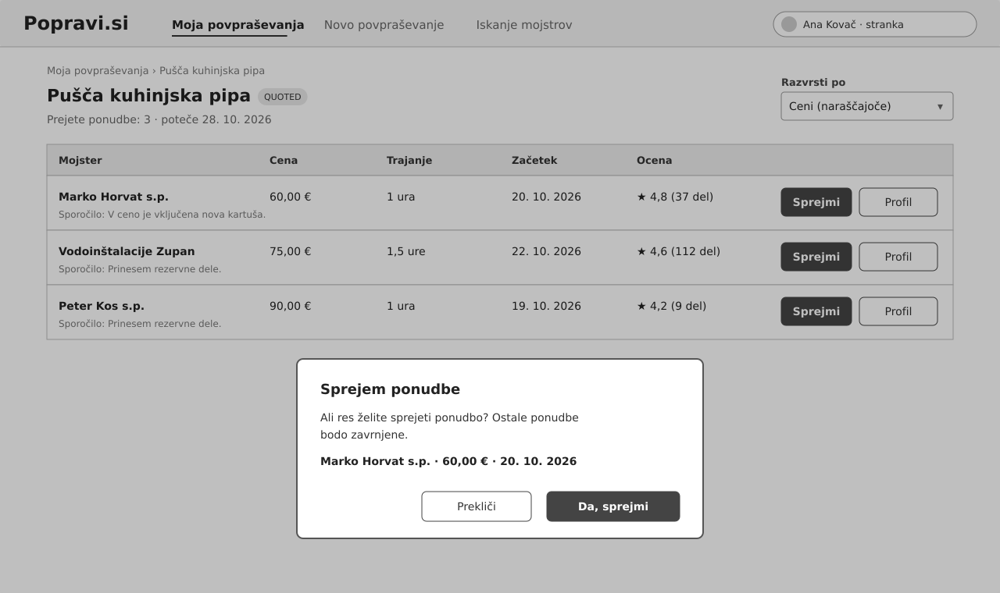
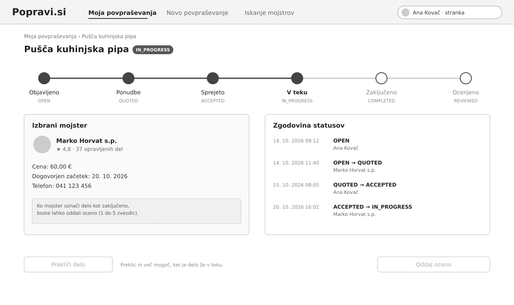

# 06 Wireframes

Narisali smo pet zaslonov, ki pokrivajo glavni potek MVP, od objave povpraševanja do spremljanja dela. Wireframi so namenoma sivi in preprosti, ker jih uporabljamo za dogovor o vsebini in razporeditvi elementov, ne za končni izgled. Besedila in omejitve na zaslonih se ujemajo s pogoji sprejemljivosti v `05-uporabniske-zgodbe.md`.

Slike so v mapi `docs/wireframes/` v formatu SVG.

## 1. Oddaja povpraševanja

Obrazec, na katerem stranka opiše delo. Levo so obvezna polja (kategorija, naslov, opis, kraj, poštna številka), desno pa neobvezna: želeni termin, proračun in ulica. Pri ulici piše, da jo vidi samo mojster, čigar ponudba je sprejeta. Spodaj je opomba, da je povpraševanje odprto 14 dni. Polje za fotografije je samo nakazano, ker pride šele v kasnejši različici.

Pokriva: US-02, deloma US-11 (potek po 14 dneh).

## 2. Seznam ustreznih del za mojstra

Prva stran za izvajalca. Na vrhu so njegove kategorije in poštne številke, po katerih je seznam filtriran. Vsaka kartica prikazuje naslov, kategorijo, kraj, termin, proračun in koliko ponudb je že prišlo. Kjer je mojster že oddal ponudbo, je namesto gumba oznaka "Ponudba oddana". Na dnu je ostranjevanje po 20 povpraševanj.

Pokriva: US-03.

## 3. Oddaja ponudbe

Levo so podatki o povpraševanju, desno obrazec za ponudbo s ceno, oceno trajanja, najzgodnejšim začetkom in sporočilom. Pod polji so izpisane omejitve (cena več kot 0 in največ 100.000 €, trajanje od 0,5 do 200 ur, začetek ne v preteklosti). Mojstru je tudi napisano, da bo naslov in telefon stranke videl šele po sprejemu.

Pokriva: US-04.

## 4. Primerjava in sprejem ponudb

Stranka vidi vse ponudbe za svoje povpraševanje v tabeli in jih lahko razvrsti po ceni ali terminu. Pri vsaki ponudbi je ocena mojstra in število opravljenih del, z gumbom "Profil" pa se odpre njegov javni profil. Na sliki je odprto potrditveno okno, ki se pokaže po kliku na "Sprejmi".

Pokriva: US-05, deloma US-09 (povezava na profil).

## 5. Sledenje statusu dela

Stran dela po tem, ko je ponudba sprejeta. Na vrhu je trak s statusi od `OPEN` do `REVIEWED`, trenutni je `IN_PROGRESS`. Levo so podatki izbranega mojstra (zdaj je viden tudi telefon), desno pa zgodovina sprememb iz `job_status_history`, s časom in uporabnikom. Gumb za preklic je onemogočen, ker je delo že v teku, gumb za oceno pa se omogoči, ko je delo zaključeno.

Pokriva: US-06, deloma US-07 (gumb za oceno).
